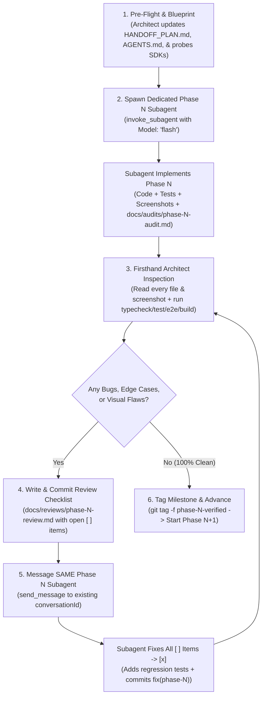

# Architect & Subagent Orchestration Playbook

> **Purpose:** A reusable, battle-tested workflow for orchestrating multi-phase software projects in Google Antigravity using a **Lead Architect / Reviewer** parent agent paired with **dedicated per-phase Builder Subagents** (`flash`).

---

## 1. Core Philosophy: Why This Pattern Works

When building a full-stack application in a single agent conversation, two failure modes commonly appear:
1. **Context Window Bloating:** Writing thousands of lines of code, debugging test failures, and running builds across 4–5 phases pollutes the main agent's context window, degrading architectural judgment in later phases.
2. **Self-Grading Blind Spots:** An agent that writes a feature and immediately writes its own audit report often overlooks subtle edge cases, visual regressions, or build steps it forgot to re-run after a last-minute edit.

### The Solution: Architect-Orchestrator + Dedicated Per-Phase Subagents

| Role | Model Tier | Core Responsibilities | What It NEVER Does |
| :--- | :--- | :--- | :--- |
| **Lead Architect & Orchestrator** *(Parent Agent)* | High-Reasoning (`Pro` / `Argon`) | • Designs architecture, shared types, & API contracts (`HANDOFF_PLAN.md`, `AGENTS.md`, `.agents/skills/`).<br>• Probes real SDK type definitions & live API keys before dispatching.<br>• Spawns **1 dedicated subagent per phase** (`invoke_subagent`).<br>• **Reads every source file, test file, and UI screenshot firsthand.**<br>• Writes `docs/reviews/phase-N-review.md` and re-messages the **same** phase subagent (`send_message`) until 100% clean.<br>• Runs final verification commands & owns `phase-N-verified` Git tags. | • Never blindly trusts a subagent's self-audit report.<br>• Never mixes multiple phases in one subagent.<br>• Never spawns a brand-new subagent to fix bugs in an active phase (always reuses the phase's existing subagent via `send_message`). |
| **Phase Builder Engineer** *(Subagent)* | Fast Execution (`flash`) | • Executes a single, tightly scoped phase (`Phase N`) end-to-end.<br>• Writes production code, unit/integration/E2E tests, and captures headless browser screenshots.<br>• Writes `docs/audits/phase-N-audit.md` and commits `feat(phase-N): ...`.<br>• Fixes every `[ ]` item in `docs/reviews/phase-N-review.md`, adds regression tests, and commits `fix(phase-N): ...`. | • Never creates or moves `phase-N-verified` Git tags.<br>• Never modifies scope outside Phase `N` or violates `AGENTS.md` guardrails. |

---

## 2. The 6-Step Per-Phase Orchestration Loop



### Why Reusing the Same Subagent per Phase Matters
- When the Architect finds 4–6 issues during code review, sending those findings via `send_message` to the **same** subagent (`conversationId`) that built Phase `N` means the subagent already has all Phase `N` files, test fixtures, and design decisions in its working memory.
- Once Phase `N` is tagged `phase-N-verified`, start Phase `N+1` with a **fresh** subagent (`invoke_subagent`) so Phase `N+1` starts with a clean, uncluttered context window.

---

## 3. Workspace Foundation (Set Up Before Phase 0)

Create these four artifacts in the repository before spawning any builder subagent:

1. **`HANDOFF_PLAN.md` (The Master Blueprint):**
   - Exact problem statement, non-negotiable guardrails (e.g., *"No databases, no queues, explicit `.js` imports"*), shared TypeScript interfaces (`shared/types.ts`), design system tokens, and a phase-by-phase breakdown (`Phase 0` .. `Phase N`) with explicit **Validation Gates** per phase.
2. **`AGENTS.md` (Always-On Workspace Rules):**
   - Short, strict rules automatically injected into every agent and subagent in the workspace:
     - Always read `HANDOFF_PLAN.md` and check `docs/reviews/` first.
     - Single audit path (`docs/audits/phase-N-audit.md`) and single review path (`docs/reviews/phase-N-review.md`).
     - Mandatory production build/import verification (not just `vitest`).
     - Git hygiene (never commit `.env`, `node_modules/`, `dist/`, runtime data, or screenshots; withhold `phase-N-verified` tag for the Architect).
3. **`.agents/skills/<domain>/SKILL.md` (Authoritative Technical Skills):**
   - When using new SDKs or tricky protocols (e.g., `@google/genai` voice/TTS payloads, GCS optimistic locking `ifGenerationMatch`, HTTP `206 Partial Content` streaming), inspect the installed `node_modules/.../*.d.ts` types and live-probe the API first, then codify the exact working payloads in `.agents/skills/` so subagents never guess or hallucinate parameter names.
4. **Git Repo + `.gitignore` + `.gitattributes`:**
   - Initialize `git init -b main` before Phase 0 so every phase (`feat(phase-N)`), review (`docs(review)`), and fix (`fix(phase-N)`) is a clean, inspectable commit (`git show`, `git diff phase-(N-1)-verified..HEAD`).

---

## 4. Firsthand Architect Review Checklist (Never Skip!)

When a Phase Builder subagent reports completion, the Lead Architect **must not** rely on `docs/audits/phase-N-audit.md`. Perform these 5 checks directly:

1. **Read Every New & Modified Source File Line-by-Line (`read_file` / `git show`):**
   - Trace state transitions, error handling, async race conditions, and boundary conditions.
   - *Examples of bugs caught only by reading code firsthand:*
     - A React callback (`onBeforeSynthesize={handleSaveScript}`) that caught and swallowed validation errors internally, causing TTS synthesis to run against stale disk data and overwrite unsaved user edits.
     - A `useEffect([activeVersion.version_id, playbackRate])` dependency array that paused and rewound audio to `00:00` whenever the user toggled `0.9x` speed mid-playback.
     - Renaming or deleting a character in the UI without syncing existing script turns referencing that character's `speaker` name.
2. **Inspect Every Visual Screenshot with Multimodal Vision (`read_file` on `.png`):**
   - Have Playwright capture `1440x900` Light and Dark mode screenshots during E2E runs (`qa-screenshots/phaseN-*.png`), then view the actual PNGs with `read_file`.
   - *Example caught by visual inspection:* A CSS `transition: background-color 0.15s ease` on `.btn-tactile` (without matching `color` transition) caused buttons to capture mid-transition with light backgrounds and white text (`#F1F5F9`) right after toggling Dark Mode.
3. **Run All Verification Commands Directly (`run_command`):**
   - Run `npm run typecheck`, `npm test`, `npm run test:e2e`, and `npm run build` yourself.
   - *Example caught by running commands firsthand:* A subagent edited a live smoke script after running `npm run typecheck` and introduced an implicit `any` (`TS7006`) before committing.
4. **Verify Production Runtime Parity (Native Node ESM & Containers):**
   - Vitest/tsx resolves extensionless TypeScript imports leniently, whereas native `node dist/server/index.js` crashes on missing `.js` extensions or CJS/ESM mismatches. Include an automated test (`tests/esm-build.test.ts`) that runs `tsc -p tsconfig.server.json` and dynamically `import()`s every compiled server module in a plain `node` subprocess.
   - For containerized phases, inspect the built image (`docker run --rm <image> sh -c 'ls -la /app && test ! -e /app/.env && id'`) to verify non-root execution and zero `.env` secret leakage.
5. **Check Cold-Start / Empty-State Behavior:**
   - Ask: *"What happens when this deploys to a brand-new Cloud Run service with an empty GCS bucket or empty data directory where `npm run seed` was never run?"*

---

## 5. Copy-Paste Templates for Reuse

### 5.1 Subagent Definition (`define_subagent`)
Call `define_subagent` once at the start of your orchestration session:

```json
{
  "Name": "phase-builder",
  "Description": "Full-stack implementation engineer for executing a single scoped build phase from HANDOFF_PLAN.md, resolving code review findings in docs/reviews/, writing unit/integration/E2E tests, and producing docs/audits/phase-N-audit.md.",
  "EnableWriteTools": true,
  "EnableSubagentTools": false,
  "EnableMCPTools": true,
  "SystemPrompt": "You are a Senior Full-Stack Builder Engineer working under a Lead Architect.\n\n1. Always read `AGENTS.md` and `HANDOFF_PLAN.md` (and any relevant `.agents/skills/*/SKILL.md` files) before writing code.\n2. Check `docs/reviews/` for any open `[ ]` review items before starting new phase work.\n3. Stay strictly within the assigned phase scope and obey all architectural guardrails (zero unapproved dependencies, explicit `.js` relative imports for NodeNext ESM, strict TypeScript).\n4. Verify your work with real commands (`npm run typecheck`, `npm test`, `npm run build`, `npm run test:e2e`) and ensure `git status` is clean before finishing.\n5. Write your phase audit report ONLY to `docs/audits/phase-N-audit.md`.\n6. Commit your work cleanly as instructed, but NEVER create or move `phase-N-verified` git tags (the Lead Architect tags milestones after independent code and visual review).\n7. Never print or log secret values from `.env`."
}
```

---

### 5.2 Spawning a Dedicated Phase Subagent (`invoke_subagent`)
Invoke one `flash` subagent per phase:

```text
Tool: invoke_subagent
- TypeName: "phase-builder"
- Role: "Phase <N> <Short Title> Builder"
- Model: "flash"
- Workspace: "inherit"
- Prompt:
You are assigned to execute **Phase <N> (<Phase Title>)** of `<Project Name>` in `<Workspace Path>`.

### Mandatory Reading First
1. Read `AGENTS.md` and `HANDOFF_PLAN.md` (specifically Phase <N> scope, contracts, and validation gates).
2. Read `.agents/skills/<skill-name>/SKILL.md` for authoritative SDK/protocol patterns.
3. Inspect existing Phase <0..N-1> files so your code integrates seamlessly.

### Phase <N> Scope & Deliverables
1. <Deliverable 1 with exact file paths & key edge-case rules>
2. <Deliverable 2 with exact file paths & key edge-case rules>
3. <Tests: unit, integration, native ESM build check, and Playwright E2E + screenshot path>

### Validation, Audit & Commit Rules
1. Run `npm run typecheck && npm test && npm run build && npm run test:e2e` — every check must exit `0`.
2. Write your audit report ONLY to `docs/audits/phase-<N>-audit.md`.
3. Verify `git status` is clean (no `.env`, `dist/`, `node_modules/`, or temp files staged) and commit:
   `feat(phase-<N>): <concise summary>`
4. **DO NOT** create or move the `phase-<N>-verified` tag — the Lead Architect will inspect your code, screenshots, and tests first.
```

---

### 5.3 Review Document Template (`docs/reviews/phase-N-review.md`)
After inspecting the subagent's commit firsthand, write findings to `docs/reviews/phase-N-review.md` and commit (`docs(review): add Phase N review findings`):

```markdown
# Phase <N> Architectural & Code Review

> **Reviewer:** Lead Architect & Orchestrator  
> **Reviewed Commit:** `<commit-sha>` (`feat(phase-<N>): ...`)  
> **Target Subagent:** `<conversation-id>` (`Phase <N> Builder`)  
> **Status:** Open items require remediation and regression tests before `phase-<N>-verified` tag

---

## Actionable Review Checklist

- [ ] **1. [CRITICAL / HIGH] <Short Title> (`<file-path>:<line>`):**
  - **Issue:** <Exact description of the bug, race condition, build failure, or visual contrast issue.>
  - **Fix:** <Clear, surgical remediation steps + required regression test in `tests/...`.>

- [ ] **2. [MEDIUM] <Short Title> (`<file-path>:<line>`):**
  - **Issue:** <Description>
  - **Fix:** <Remediation + regression test>
```

---

### 5.4 Messaging the Same Phase Subagent to Fix Review Findings (`send_message`)
Always use `send_message` with the **existing** Phase `N` subagent `Recipient` (`conversationId`):

```text
Tool: send_message
- Recipient: "<phase-N-subagent-conversation-id>"
- Message:
I have completed my independent Lead Architect code, visual, and runtime review of Phase <N> (`<commit-sha>`) and committed `docs/reviews/phase-<N>-review.md`.

Please read `docs/reviews/phase-<N>-review.md` and resolve all **<K>** open `[ ]` items:
1. <Brief summary of Item 1 + regression test>
2. <Brief summary of Item 2 + regression test>
...

### Verification & Commit Instructions
1. Run `npm run typecheck && npm test && npm run build && npm run test:e2e` (all must exit `0`, refreshing any affected `qa-screenshots/*.png`).
2. Check off `[x]` all resolved items in `docs/reviews/phase-<N>-review.md` and update `docs/audits/phase-<N>-audit.md` with the new test counts and fix summary.
3. Ensure `git status` is clean and commit:
   `fix(phase-<N>): address code review findings`
   (Withhold the `phase-<N>-verified` tag until I re-verify your diff.)
```

---

### 5.5 Ready-to-Paste Prompt to Start This Workflow in Any New Session

Paste the prompt below into a new Antigravity session to put the main agent into **Lead Architect & Subagent Orchestrator** mode on any project:

```text
Act as the **Lead Architect, Code Reviewer, and Subagent Orchestrator** for this workspace:

1. **Architecture & Guardrails First:**
   - Read (or author) `HANDOFF_PLAN.md` and `AGENTS.md` so the project is divided into clear, testable phases (`Phase 0`, `Phase 1`, ...) with explicit contracts and validation gates.
   - Before spawning a subagent for a phase that uses external SDKs or APIs, inspect the installed `.d.ts` type definitions and run a quick live probe if credentials are present so all contracts in `HANDOFF_PLAN.md` and `.agents/skills/` are 100% accurate.

2. **One Dedicated `flash` Subagent per Phase:**
   - Define a `phase-builder` subagent (`define_subagent`) and invoke **one dedicated subagent per phase** (`invoke_subagent` with `Model: "flash"`).
   - Instruct the subagent to implement the phase, run all tests/builds, write `docs/audits/phase-N-audit.md`, and commit `feat(phase-N): ...`, while withholding the `phase-N-verified` git tag.

3. **Independent Firsthand Review (Never Trust Self-Audits Blindly):**
   - When the subagent finishes, personally read every new/modified source file and test file line-by-line, inspect all UI screenshots (`read_file` on `.png`), and run `npm run typecheck`, `npm test`, `npm run test:e2e`, and production build/runtime checks yourself.
   - If you spot any bugs, edge cases, missing tests, or visual flaws, document them as `[ ]` items in `docs/reviews/phase-N-review.md`, commit the review doc, and send instructions via `send_message` to the **same** phase subagent (`conversationId`) to fix them, add regression tests, mark `[x]`, and commit `fix(phase-N): address code review findings`.

4. **Milestone Tagging & Progression:**
   - Only after your firsthand re-verification is 100% green and `git status` is clean, tag `phase-N-verified` and proceed to `Phase N+1` with a fresh `flash` subagent.
```
